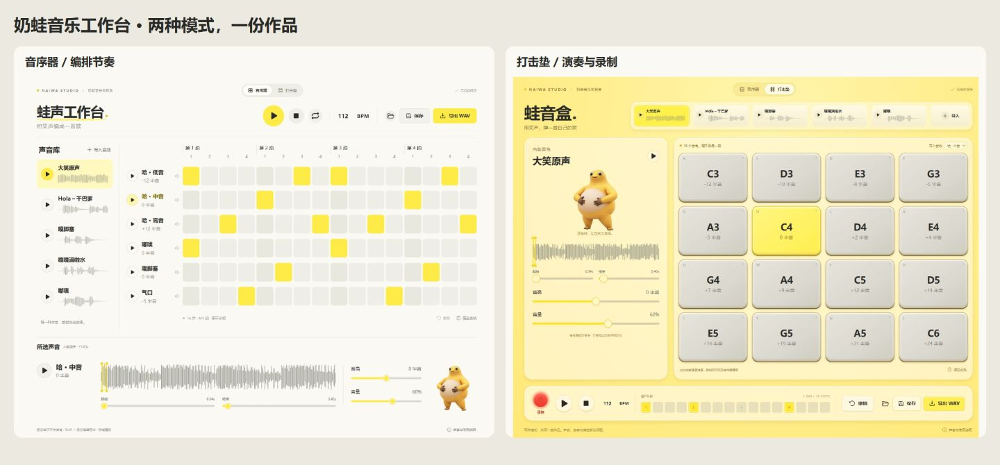

# 奶蛙 Studio

把一声“哈”变成一段旋律。奶蛙 Studio 是一个在浏览器里运行的采样音序器：用奶蛙大笑和其他网络语音编节奏、弹旋律，再导出为 WAV。

[GitHub 仓库](https://github.com/Theorists258/naiwa-studio)



## 两种模式，一首作品

- **音序器**：默认 6 条音轨，每轨 16 步，对应一个 4/4 小节。支持音轨和单步音高、音量、静音、片段裁切、清空及撤销，速度范围为 40–240 BPM。
- **打击垫**：16 个相对音高，支持点击和键盘演奏。开启录制后，每次击打写入当前音轨正在播放的步点；同一步再次击打会替换该音符。
- **随时切换**：两种模式共享声音、音轨和编曲状态。可以先用打击垫录一段，再切回音序器修改。
- **保存与导出**：自动保存在当前浏览器，支持下载和打开 JSON 工程；WAV 导出包含 4 次循环并保留尾音。

内置大笑、呼啦干巴爹、嘎脚塞、嘎嘎地拉水和嘟噗 5 款音源，也可以导入自己的声音。音频解码、播放和导出都在浏览器内完成，无需后端音频服务。

## 快速启动

环境：**Node.js 24.12+（24 LTS）**、**pnpm 11.25.0**。包管理器版本记录在 `package.json` 中。

在项目目录运行：

```bash
pnpm install --frozen-lockfile
pnpm dev
```

打开终端输出的本地地址。首次播放或试听需要点击界面，让浏览器启动音频上下文。

## 操作

1. 选择一条音轨，再从声音库选择音源；调整起止位置，截取要使用的一声笑或一段短语。
2. 点击音序器格子添加或删除音符。按住 `Shift` 点击已有音符，可调整该步的音高偏移。
3. 切换到打击垫，选择“写入音轨”，点击“录制”开始循环录入。点击“结束录制”保留乐段。
4. 点击“保存”下载工程，或点击“导出 WAV”生成音频。文件夹按钮可打开以前保存的工程。

空格切换播放与停止；停止按钮回到开头。在输入框中编辑文字或数值时，快捷键不会打断输入。

打击垫键位按界面顺序为 `asdfghjkqwertyui`：

| 按键 | A | S | D | F | G | H | J | K |
| --- | --- | --- | --- | --- | --- | --- | --- | --- |
| 相对音名 | C3 | D3 | E3 | G3 | A3 | C4 | D4 | E4 |
| 按键 | Q | W | E | R | T | Y | U | I |
| 相对音名 | G4 | A4 | C5 | D5 | E5 | G5 | A5 | C6 |

音名是相对参考，采样没有自动定调。最终偏移为“音轨音高 + 单步或打击垫音高”。变调通过改变播放速度实现，因此也会改变片段时长。

## 文件与限制

| 项目 | 当前行为 |
| --- | --- |
| 导入音频 | 单文件不超过 15 MiB、120 秒；导入音频合计按 Base64 体积限制约 30 MiB |
| 音频格式 | 接受浏览器能够解码的 MP3、WAV 等文件，具体格式支持取决于浏览器 |
| 工程文件 | `.naiwa.json` 包含编曲参数和导入音频；内置音源引用项目自带的 `/audio/` 文件 |
| 打开工程 | 文件不超过 35 MiB；打开后替换当前作品，请先保存需要保留的内容 |
| 导出音频 | 4 次循环，保留尾音；44.1 kHz、双声道、16 位 PCM WAV |

自动保存使用当前浏览器的本地存储。浏览器配额不足或存储不可用时，界面会提示下载作品保存。较大的导入音频可能超过浏览器的存储配额，请用工程文件备份；清除网站数据也会删除自动保存的作品。

## 开发与检查

技术栈：React、Vite、Web Audio API、Phosphor Icons。

```bash
pnpm test
pnpm build
pnpm test:sites
```

`test:sites` 会检查构建产物，因此需要先完成 `pnpm build`。

构建后的前端在 `dist/client/`，使用 `pnpm preview` 可以本地预览。构建脚本还会准备托管适配文件 `dist/server/index.js` 和 `dist/.openai/hosting.json`；构建本身不会执行发布。

| 路径 | 用途 |
| --- | --- |
| [src/App.jsx](src/App.jsx) | 两种视图、录制、导入和工程保存 |
| [src/music.js](src/music.js) | 默认乐段、音源表、键位和工程校验 |
| [src/audio-engine.js](src/audio-engine.js) | 音频解码、采样变调、播放调度和 WAV 渲染 |
| [tests](tests) | 音频引擎、工程数据与托管适配测试 |
| [public/audio](public/audio) | 内置 MP3 音源 |
| [public/assets](public/assets) | 界面角色图片 |

贡献流程见 [CONTRIBUTING.md](CONTRIBUTING.md)。

## 许可与素材

原创程序代码使用 [MIT License](LICENSE)。**第三方 MP3、角色形象及相关权利不包含在代码 MIT 授权范围内**；公开下载地址不等于素材已获得开源或商用授权。

素材来源、固定版本与哈希见 [ASSET-SOURCES.md](ASSET-SOURCES.md)，权利边界与依赖说明见 [THIRD_PARTY_NOTICES.md](THIRD_PARTY_NOTICES.md)。复用或分发素材时，请确认相应权利，也可以替换为自己有权使用的音频与形象。
